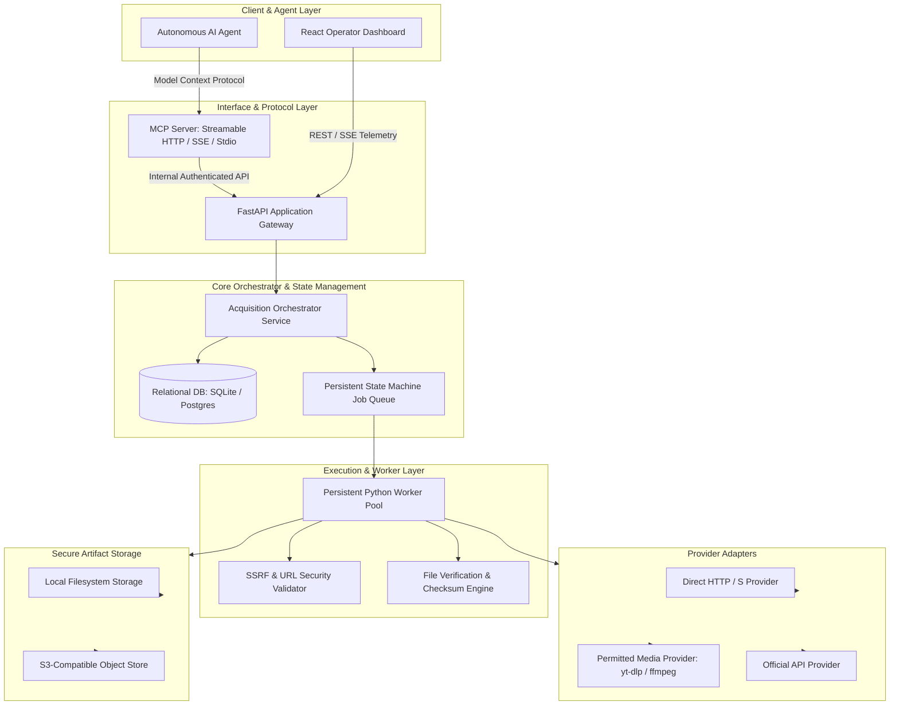

# System Architecture: Agent Acquisition Engine

## Architectural Decoupling

1. **MCP Server (`services/mcp-server`)**:
   Exposes standard MCP endpoints (`inspect_source`, `list_formats`, `preflight_acquisition`, `request_approval`, `start_acquisition`, `get_job_status`, `get_artifact`). It acts as a lightweight protocol translator, delegating all operations to the core API over authenticated internal transport.

2. **API Gateway (`apps/api`)**:
   FastAPI application managing REST routes, JWT/API-key authentication, user session ownership, database ORM persistence, signed download link generation, and audit logging.

3. **Persistent Worker (`services/acquisition-worker`)**:
   A dedicated background daemon that continuously polls for `queued` jobs, executes provider-specific downloads via streaming chunk pipes, runs integrity verification, writes artifacts to storage, and writes granular `job_events`.

4. **Provider Adapter Interface (`packages/provider-contracts`)**:
   All source handlers implement `BaseProviderContract`:
   - `can_handle(source: SourceReference) -> bool`
   - `inspect(source: SourceReference) -> SourceInspectionResult`
   - `list_formats(source: SourceReference) -> list[FormatOption]`
   - `check_permissions(source: SourceReference) -> PermissionAssessment`
   - `acquire(selection: AcquisitionSelection, progress_callback) -> AcquisitionRawResult`
   - `verify(raw_file: Path, expected: VerificationExpectation) -> VerificationResult`

5. **Storage Abstraction (`apps/api/app/services/storage.py`)**:
   Supports local filesystem and S3. Direct external access to raw paths is disabled; all file downloads flow through an expiring signed HMAC token endpoint.
